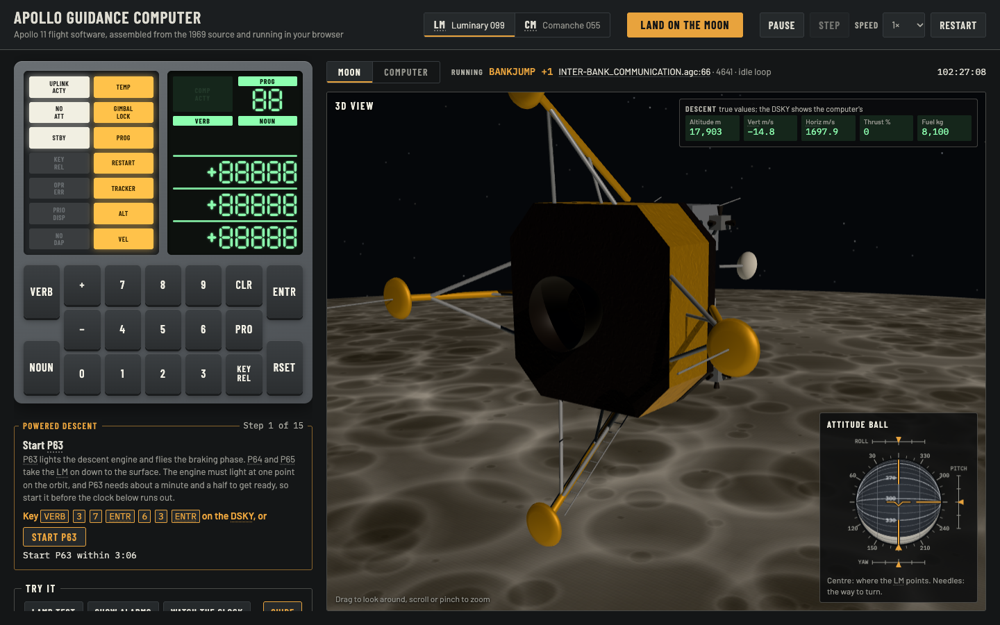
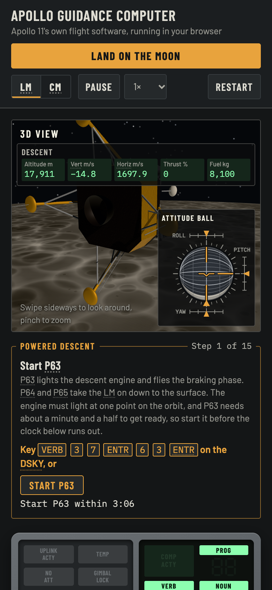

# Apollo 11 Guidance Computer, in the browser

A web app that runs the **original Apollo 11 flight software** on an emulated
Apollo Guidance Computer (AGC), with a working DSKY (the crew's display and
keyboard) and a live view of the 1969 source code as it executes. In the
Lunar Module, the computer flies a simulated spacecraft: the original
autopilot reads the IMU and fires the RCS jets.



The source is not translated or rewritten. The page loads the original
`.agc` files from [chrislgarry/Apollo-11](https://github.com/chrislgarry/Apollo-11),
assembles them in the browser into the 36 banks of core rope, and runs that
rope instruction by instruction:

| Program          | Spacecraft                 | Assembled rope vs. the 1969 listing |
| ---------------- | -------------------------- | ----------------------------------- |
| **Luminary 099** | Lunar Module *Eagle*       | 36,864 of 36,864 words identical    |
| **Comanche 055** | Command Module *Columbia*  | 36,864 of 36,864 words identical    |

## Running it

You need Node.js 20 or later.

```sh
git submodule update --init   # fetches the original source into vendor/Apollo-11
npm install
npm run dev                   # http://localhost:5173
```

Other commands:

```sh
npm test                      # assembler + emulator tests (about 5 s)
npm run build                 # static site in dist/, deployable to any static host
npm run assemble -- Comanche055 --compare   # assemble from the command line, compare with the 1969 listing
```

## Deploying

Every push to `main` runs the tests, builds the site and deploys it to
<https://apollosim.app> with GitHub Actions (`.github/workflows/deploy.yml`).
The site is a Cloudflare Worker that serves the static files in `dist/`
(`wrangler.jsonc`). The workflow needs two repository secrets:
`CLOUDFLARE_API_TOKEN` and `CLOUDFLARE_ACCOUNT_ID`.

## Trying the DSKY

Click the keys or type on your keyboard: digits, `V` (VERB), `N` (NOUN),
`Enter` (ENTR), `C` (CLR), `P` (PRO), `K` (KEY REL), `R` (RSET). Hover
over a key, a lamp, or a dotted-underlined short form such as T4RUPT or V99
to see what it means; verb and noun names come from the loaded program's
own lists. So do the alarm codes: when the PROG lamp lights, key VERB 05
NOUN 09 and hover over a code on the DSKY, or search the Alarm codes tab of
the Guide. The "Try it" chips under the DSKY key the most useful commands in
one click, and the Guide beside them has every ready-made sequence:

| Keys                  | What it does                                                            |
| --------------------- | ----------------------------------------------------------------------- |
| `V35E`                | Lamp test                                                               |
| `V05N09E`             | Show alarm codes (01107 at power-up: erasable memory was blank)         |
| `V16N65E`             | Monitor the clock                                                       |
| `V37E00E`             | Change major mode to P00                                                |
| `V11N01E 25E`         | Monitor a memory word (address 25 is TIME1)                             |
| `V21N27E 10E`         | Run the AGC's built-in self-check                                       |

## Flying the LM

With the LM program selected, the panel under the DSKY is the spacecraft:
the 16 RCS jets seen from above (lit while firing), the IMU gimbal angles,
the body rates, the PGNS mode switch and a hand controller.

The right column shows either the Moon or the Computer (registers and
listing); "Land on the Moon" turns it to the Moon. There the 3D view shows the
LM at its current attitude against the stars, with a plume on each jet while
it fires. Drag to look around and scroll to zoom; on a touch screen, swipe
sideways and pinch.

In its corner, the attitude ball (FDAI) stands for the stable member, which
holds still in space while the LM turns around it; its centre shows where
the front of the LM points. The needles across the ball are the attitude
errors the flight software sends through the CDU error counters (its NEEDLER
routine), and the pointers outside the ball show the body rates. Full scale
is 5° of error and 5°/s of rate.

1. Wait about 12 s after the page loads. The software zeroes the IMU's angle
   counters and lets them count up to the gimbal angles, then wakes the
   digital autopilot (DAP). The status changes to "Autopilot: attitude hold".
2. Click **Load the autopilot data** in the Guide. Verb 48 gives the DAP its
   settings and the LM weight. Without the weight it misjudges its jets.
3. Click **Disturb**. The LM starts turning; the DAP fires jets to stop it.
4. Fly: hold <kbd>↑</kbd> <kbd>↓</kbd> (pitch), <kbd>←</kbd> <kbd>→</kbd>
   (roll), <kbd>A</kbd> <kbd>D</kbd> (yaw), or the on-screen buttons. The
   stick asks the DAP for a rate; the DAP fires the jets.
5. Set the mode switch to **Auto** and click **Turn to an attitude (V49)**.
   When V50 N18 flashes, press PRO: the attitude maneuver routine turns the
   LM to the keyed gimbal angles at 2°/s.

| Keys                                             | What it does                                     |
| ------------------------------------------------ | ------------------------------------------------ |
| `V48E V21E 21102E PRO V21E +33290E PRO PRO`      | DAP data: 0.3° deadband, 2°/s, LM weight 33,290 lb |
| `V16N20E`                                        | Monitor the IMU gimbal angles                    |
| `V37E00E V49E V25E +04500E +01000E +00000E PRO`  | Maneuver to gimbal angles 45°, 10°, 0° (mode Auto) |

### Powered descent

The original P63, P64 and P65 can fly Apollo 11's landing, from engine
ignition to touchdown at Tranquility Base.

1. Click **Land on the Moon** at the top of the page. The computer restarts
   at 102:27:00 mission time: the LM is in its descent orbit 18 km up, the
   IMU is aligned to the landing site, and memory holds the 1969 pre-launch
   erasable load. The DSKY then clears the restart alarm and loads the
   autopilot data. **Set up powered descent** in the Guide does the same.
2. In the descent checklist under the DSKY, click **Start
   P63**. P63 computes the ignition time, about 102:32:50 (Apollo 11 lit at
   102:33:05). Start it by 102:30:15; the checklist counts down to then.
   Later than that, the computer will most likely slip the ignition (alarm
   1703): the burn starts past the point it was planned for, and the descent
   misses the landing site. The checklist warns you when that happens.
3. Answer P63 on the DSKY. For each question the checklist explains what
   it means and lights up the key that answers it. Press the lit key, or
   click **Press it for me**. The questions are:
   - **V06 N61** flashing (ignition time computed): press PRO.
   - **V50 N25 with 00014** flashing (fine alignment offered): press ENTR to
     skip it.
   - **V50 N18** flashing (turn to the ignition attitude?): press PRO. The
     LM turns, and the DSKY shows V06 N18 without flashing.
   - **V50 N18** flashing again (the turn is done): press ENTR to accept the
     attitude. The DSKY then stays blank for about 5 minutes.
   - **V99** flashing, 5 s before ignition (enable the engine?): press PRO.
     A late answer lights the engine late; 30 s after the ignition time P63
     gives up with alarm 1406.
4. Watch the burn. The jets fire for ullage, the engine lights at minimum
   thrust, and 26 s later it goes to full throttle. About 6 minutes in, the
   computer turns the LM windows up, the landing radar sees the ground, and
   the ALT and VEL lamps go out.
5. Key **V57** (VERB 5 7 ENTR), or click **Key it in for me**. From then on
   the computer corrects its altitude and velocity with the radar's.
6. P64 starts at high gate, about 2 km up, and pitches the LM up. Near the
   ground P65 takes over and lets the LM down at 1 m/s. At the contact
   light, click **Stop the engine**. The LM lands about 12 minutes after
   ignition, within about 100 m of the planned site.

While the crew waits, for the turn, for ignition, or during the burn, the
checklist's **Fast-forward** button runs the simulation at 20× until the
next step, then returns to the speed you had. The other way round, when the
checklist asks you to press a key, the simulation runs in real time until
you do, then returns to the speed you had: at 100× a question would be gone
before you could read it. A speed you choose while a question waits stays.

During the descent the 3D view's corner shows the LM's true altitude, its speeds
against the ground, thrust and propellant. The DSKY shows what the computer
believes, for example in noun 63. The 3D view follows the LM: up is away
from the Moon, the ground moves past below, and the descent engine's plume
grows with thrust.

The landing radar measures the slant range along its altitude beam and the
velocity against the turning ground along its antenna's three axes. Its
geometry and scale factors are the ones the software uses: the antenna
angles from the pad load, the altitude beam direction, and the feet per
count of each reading. Without V57 the computer navigates on the IMU alone.
Its altitude then drifts about 50 m high by high gate, because its
powered-flight gravity treats the Moon as a sphere, and the LM reaches the
ground before the computer expects it.



## How it works

```
vendor/Apollo-11/          original source (git submodule, public domain)
src/yul/                   the assembler
src/agc/                   the AGC emulator and the DSKY interface
src/sim/                   the spacecraft: LM attitude and orbit, RCS jets, descent engine, IMU, panel switches
src/ui/                    the web page, including the 3D view (three.js)
test/                      tests, and the 1969 octal listings used to check the assembler
```

**Assembler (`src/yul`).** A TypeScript implementation of the MIT YUL
assembler's Block II language: basic and extracode instructions, the
interpretive language (opcode pairs, indexed operands, `STADR`, switch and
shift operands), and the pseudo-operations (`SETLOC`, `BANK`, `EBANK=`,
`SBANK=`, `2CADR`, `BBCON`, `2DEC`, …), including the bank checksum
("bugger") words. It runs in a Web Worker and takes about 0.6 s for each
program. The tests compare every word of the output with transcriptions of the
octal listings printed in July 1969 (`test/fixtures/*.binsource`, public
domain, from the Virtual AGC project).

**Emulator (`src/agc`).** Implements 15-bit ones'-complement arithmetic,
16-bit A/L/Q registers with overflow, banked erasable and fixed memory with
the superbank, all instructions and extracodes, interrupts, the TIME1–TIME6
counters, I/O channels, the DSKY relay words, and the hardware alarms (night
watchman, rupt lock, TC trap) that force a restart. The flight software's own
self-check (`V21N27E 10E`) passes: the instruction tests, the erasable memory
test, and checksums of all 36 rope banks.

**Spacecraft (`src/sim`).** The LM is a rigid body with 16 RCS jets, an
IMU and a hand controller, connected to the computer only through I/O
channels and counter pulses, as in the real spacecraft. The jets fire from
the bits the software writes to channels 5 and 6. The IMU's angle counters
(CDUs) count gimbal motion into CDUX, CDUY and CDUZ, the accelerometers count
into the PIPA registers, and the computer drives the gimbals (coarse align)
and torques the gyros through its output counters. The same counters drive
the FDAI's error needles while channel 12 bit 6 enables them. The mode switch, IMU
switch and hand controller appear in channels 30, 31 and the RHC counters.
The physical constants come from the flight software itself: 100 lbf jets
at a 5.5 ft lever arm, moments of inertia from the DAP's own curve fits
against mass, 1 cm/s per accelerometer pulse. The jet wiring was worked out
from the DAP's jet-selection tables, and a test checks it against them.

In orbit the LM also moves. The Moon's gravity is the field the software's
own coasting integration models: the point mass, J2 and J3 from fixed
memory, and the C22 and C31 bulge terms from Apollo 11's pad load. The Moon
turns as the software's MOONMX routine says. The descent engine takes its
on and off commands from channel 11, its throttle from THRUST counter
pulses, and its trim gimbal from channel 12. The landing radar starts a
read when the software sets channel 13, puts its count in RNRAD and ends
with a RADARUPT, and reports data good, range scale and antenna position in
channel 33. On the surface the legs hold the LM, and the accelerometers
feel the ground pushing up. The powered-descent setup
(`src/sim/descent.ts`) loads the pre-launch erasable values from the Grumman
LM Data Book table "LGC Prelaunch Erasable Load (Luminary 99)" (11 June
1969). The state vectors were uplinked during the flight, so the setup
builds a descent orbit through the landing site instead.

**Web page (`src/ui`).** The DSKY, a listing of the source in the 1969 format
(location, octal words, source line), and the computer's state, on the
Computer side of the right column. "Follow: Last job"
tracks the code the Executive is running: key in a verb and the listing jumps
into PINBALL, the DSKY program. Inside the interpreter it shows the interpretive
instruction being executed. Lines that ran in the last moment get a green
marker. Each line number, the file name and the "Running" location link to the
same line in chrislgarry/Apollo-11 on GitHub, at the commit checked out in
`vendor/Apollo-11`, so the line numbers always match.

Both pieces were written for this project. The Virtual AGC project's yaYUL
and yaAGC (GPL) were the reference for the exact behaviour of the assembler
and of the hardware. No code was copied from them.

## Notes on the upstream source

The submodule is used unmodified. Two kinds of problem in the upstream copy
are handled when the source is loaded (see `src/programs.ts`):

- **Luminary099 include names.** Upstream renamed
  `LAMBERT_AIMPOINT_GUIDANCE.agc` and `TRIM_GIMBAL_CNTROL_SYSTEM.agc`
  without updating `MAIN.agc`, so the loader maps the old names to the new
  files.
- **Comanche055 transcription errors.** Four lines differ from the 1969
  listing. Each is corrected at load time and marked in amber in the listing:
  - a comment line in `ERASABLE_ASSIGNMENTS.agc` lost its `#`, which shifts `ALTVAR` by one word
  - the label `ZEROERROR` should be `ZEROEROR`
  - the label `GETDLEWD` should be `GETLEWD`
  - `2DEC 1.08-2` should be `2DEC 1.0 B-2`

The assembler also accepts `+n` location notes that have drifted one tab stop
to the right in a few upstream lines.

## Not simulated yet

The LM orbits and lands. Not simulated: terrain (the surface is a sphere
through the landing site), the 1201 and 1202 alarms Apollo 11 met, landing
site redesignation, the ascent engine, aborts, the crew's throttle and
rate-of-descent switch, and the rendezvous radar. The Command
Module has no spacecraft model at all. The jets sit level with the centre of
mass, so translating does not disturb the attitude, and the IMU never drifts
or tumbles in gimbal lock. Possible next steps:

- the rendezvous radar's cycle stealing, which caused the 1201 and 1202 alarms
- decoding the digital downlink (telemetry) the software sends 50 times a second
